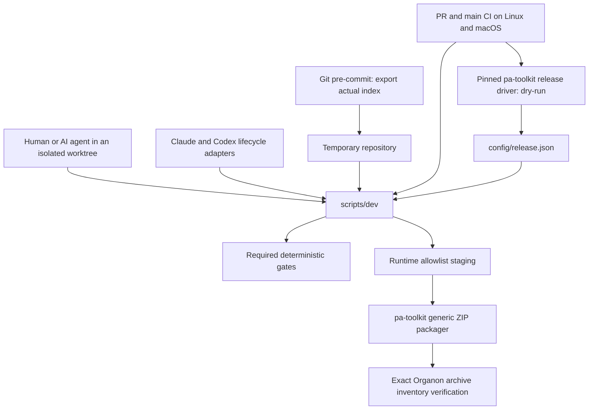

# Shared AI development architecture and maintenance

This guide describes the development system, not vault behavior or the distributed runtime skills. Read [AGENTS.md](../AGENTS.md) first, [development.md](development.md) for commands, [hook-scope.md](hook-scope.md) for client limits, and [release.md](release.md) for Organon's release extension. Historical observations and acceptance evidence live in [the verification report](verification/shared-ai-setup.md). The code is authoritative when implementation details change; update this guide in the same PR.

## Design and repository ownership

One shared contract, executable gates used by humans/agents/Git/CI, and thin client adapters prevent policy drift. Lifecycle hooks provide early feedback. Git validates the index independently of the agent. Required server checks provide the merge boundary.

| Owner | Authoritative sources | Responsibility |
|---|---|---|
| Organon | `AGENTS.md`, root `CLAUDE.md`, `.claude/CLAUDE.md` | Shared repository instructions; Claude imports the same contract |
| Organon | `scripts/dev`, `scripts/dev.py` | Worktree-aware launch, deterministic checks, staged export, lifecycle policy, diagnostics and package selection |
| Organon | `config/protected-references.json`, `kepano-version.txt` | Protected path inventory, exact-byte exceptions and provenance pin |
| Organon | `config/toolchain.json`, `pyproject.toml`, `uv.lock` | Supported executable minimums and the locked managed Python environment |
| Organon | `scripts/token-harness.py`, `tests/token-baseline.json` | Modeled content-token scenarios and the reviewed CI comparison baseline |
| Organon | `config/package-files.json`, `config/release.json` | Runtime payload allowlist and portable release extension argv |
| pa-toolkit | [shared runbook](https://github.com/folotp/pa-toolkit/blob/main/skills/plugin-release/references/runbook.md), [release.py](https://github.com/folotp/pa-toolkit/blob/main/skills/plugin-release/scripts/release.py), [package.sh](https://github.com/folotp/pa-toolkit/blob/main/skills/plugin-release/scripts/package.sh) | General release sequencing, extension selection, archive receipts and low-level ZIP construction |
| pa-toolkit | [branch-guard.py](https://github.com/folotp/pa-toolkit/blob/main/skills/plugin-release/scripts/branch-guard.py) | Generic local main guards for toolkit/marketplace; do not replace Organon's stronger staged gate |
| pa-marketplace | [automation runbook](https://github.com/folotp/pa-marketplace/blob/main/docs/protected-main.md), bumper and validator | Existing plugin pins, validation, bot PRs and exact-branch validation dispatch |

Do not copy general release orchestration into Organon, vault conventions into development tooling, or shared policy into client-specific scripts. No development check needs a vault, MCP connector, model call or user account content. Releases and live vault tests need their own authorization.

## Execution and failure contracts

The Bash launcher resolves its own worktree before dispatching. `doctor`, hook adapters, hook installation and staged export run with launcher Python 3.9+. Full checks use `uv run --locked` and managed Python 3.11+. `session` starts either client at that worktree root without granting trust, bypassing permissions or switching branches.

`check()` runs doctor, specifications, shell lint/format verification, Markdown links, README inventory, protected references, token comparisons, runtime selection and infrastructure tests in that order. A required failure stops the command; an unavailable dependency/cache is a failure with a remedy. CLI status is nonzero; no required gate is silently skipped. `format` and `baseline` are explicit write operations, separate from verification. The package-contract gate checks selection; only `package` or the release driver verifies a real archive.

For commits, `check_staged()` rejects main/detached HEAD and active resync tokens, exports the **index** into a temporary repository, fetches committed HEAD as its comparison baseline, strips inherited `GIT_*` variables, and invokes the same `check`. Unstaged repairs cannot hide a staged defect. Tests use disposable repositories and never alter the real index or vault.

The protected gate unions base/current inventories so removing an entry does not exempt changed content. A changed provenance pin permits the refresh workflow; otherwise an approved exception must match exact SHA-256 bytes and a nonempty reason. A scoped resync token is an editor allowance, never a commit allowance. See [refreshing-kepano.md](refreshing-kepano.md) before any protected-reference change.

## CI and server settings

| Repository | Workflow and triggers | Required check contexts | Actual gate |
|---|---|---|---|
| Organon | `.github/workflows/validate.yml`: PRs and pushes to main | `Checks (ubuntu-latest)`, `Checks (macos-latest)` | Full shared check, then actual dry-run via an exact pa-toolkit commit pin |
| pa-toolkit | `.github/workflows/release-checks.yml`: PRs and pushes to main | `Release checks (ubuntu-latest)`, `Release checks (macos-latest)` | Portable release and generic branch-guard regression tests |
| pa-marketplace | `.github/workflows/validate.yml`: PRs, main pushes, explicit dispatch | `Marketplace validation` | Disposable-remote workflow test and online marketplace validator |

Required check names are part of the GitHub protection contract: update settings and names together, never leave a renamed context required forever. Branch protection is configured on GitHub separately from YAML: PRs, strict/up-to-date checks, admin enforcement, no force pushes/deletion, and zero required approving reviews for the solo maintainer. Read-only validation workflows do not publish releases. The separately authorized release workflow triggers marketplace notification only after publication.

Organon fetches history for base comparisons. PR checks use the PR base SHA; main checks use the previous push SHA, falling back to the previous commit for an unavailable/all-zero event base. The second checkout lives in ignored `.tooling/pa-toolkit`, so the release driver's clean-tree gate is still meaningful. The driver creates temporary archives and a JSON receipt in the runner's temporary directory; it does not upload a release asset.

Marketplace's bot uses a deterministic branch and serializes concurrent bump runs. It merges current main, validates changes, conditionally commits generated files, **always pushes merge-only refreshes**, and opens/updates a PR. GitHub-token-created PRs do not automatically trigger PR workflows, so the bot explicitly dispatches validation on its branch. Actions needs PR-creation permission and narrowly scoped workflow permissions; it receives no protected-main bypass or automatic merge. See its runbook for failure recovery.

## Client boundaries

Native Claude file edits and Codex patch headers normalize into the same policy inputs. Check every source and move destination, resolve cwd/dot segments/symlinks, and fail unsupported or outside-repository edit inputs. Formatting/Stop feedback is bounded JSON and advisory: no hidden rewrites, no recursive Stop continuation and no success suffix after JSON. Scoped token rules remain identical across adapters.

Fresh tests documented Codex 0.167.0 loading hook definitions from the primary checkout in linked worktrees. Inspect `/hooks`, update primary checkout after merging definitions, and review/trust exact changed definitions. Root launch is the tested Claude route. Shell/MCP writes, hosted tools and cloud orchestration are not assumed lifecycle-protected. Git and CI cover source committed through those paths. A model's statement that an advisory diff reformatted a file is not evidence; inspect resulting bytes.

## How to modify this system

| Intended change | Edit and review | Required verification |
|---|---|---|
| Add/change a check | Implement in `scripts/dev.py`; route CLI/client adapters to it; explain contract near code and in docs | Focused failure/pass regression where behavior changes, full `scripts/dev check`, staged gate and both OS checks |
| Add/change a client event | Normalize payload shape once; keep one protected inventory; document matching/output/exit semantics | Payload fixtures plus fresh disposable client session; record supported/unsupported surfaces and actual bytes |
| Change dependency policy | Update minimum policy or locked Python declarations; coordinate CI installers | doctor cases for missing/old/unparseable tools; local and matrix checks; do not bypass sandbox approvals |
| Change token methodology/content | Review scenario/profile reasoning and baseline separately | Both modeled main/total aggregates; no baseline refresh merely to make a failure pass |
| Change runtime package | Update `config/package-files.json`, preserving audit references, manifests and provenance | Actual archive inventory equality and optional client validation; keep dev configuration/environments out |
| Change release behavior | Modify pa-toolkit implementation/runbook; use Organon's generic argv extension | Extension/fallback regressions, both modes, explicit output-path propagation and protected-main sequence |
| Adopt new release driver | Merge pa-toolkit PR first; pin its merged SHA in Organon CI through an Organon PR | CI's actual driver dry-run on both OSes; source changes do not update installed marketplace plugins |
| Change branch/bot policy | Coordinate Git launchers, CI contexts and server settings across repositories | Disposable remote test and live settings readback; do not manufacture a plugin release to test them |

Use one named branch and linked worktree per independently editing agent. Read the selected repository's instructions; preserve unrelated files. Keep the implementation, comments/docstrings, design reasoning, runbook commands and verification evidence consistent in the same PR. No new dependency or functional behavior should be hidden in a documentation change.

## Maintenance, diagnostics and recovery

1. Run `./scripts/dev doctor` and the failing command from the correct worktree. For uv permission/network failures, follow [setup](development.md); prepare approved/writable caches rather than skipping a gate or silently modifying global settings.
2. Identify the owning layer using the table above. A hook installation problem is not a runtime-skill problem; a source checkout is not the installed plugin cache. Keep required deterministic errors separate from the upstream-freshness advisory.
3. Preserve unmanaged hooks. Reinstall toolkit/marketplace guards from a stable toolkit checkout after moving their source; their launchers retain its absolute path. Organon's launcher instead resolves the active worktree at execution time. Both respect Git's hook-path resolution.
4. Reproduce Git/protection failures in disposable repositories. Never test destructive commands or scoped-token bypasses on actual pinned references. Do not switch another session's checkout.
5. Correct defects through a PR. Do not remove required checks, use `--no-verify`, force-push main or make a failed gate advisory to unblock a merge. Retain exact validated archive/receipt paths through a separately authorized release.
6. For dependency rollback, pin a previously reviewed merged toolkit commit through an Organon PR and run the same matrix/dry-run. For a policy rollback, align code, documentation and server contexts; keep main protected throughout.
7. After squash merges, compare the owned feature tree to main and check worktree status before cleanup. Reinstall any guard pointing into that worktree first. Preserve unrelated edits. For a squashed revert, start from current main and inspect the real triple-dot diff; see [the revert warning](development.md#branch-protection-and-reverted-work).

## Evidence and scope

[The verification report](verification/shared-ai-setup.md) records client versions, controlled prompts, event delivery, malformed/multi-file cases, branch-switch investigation and rollout checks. The historical headless branch switch was not reproduced; no cause is attributed without evidence. Remaining manual hook trust and untested surfaces are documented limits, not claims of universal hook coverage. Runtime vault evaluations, installed-plugin distribution, unrelated issue backlogs and public releases are separate projects.
